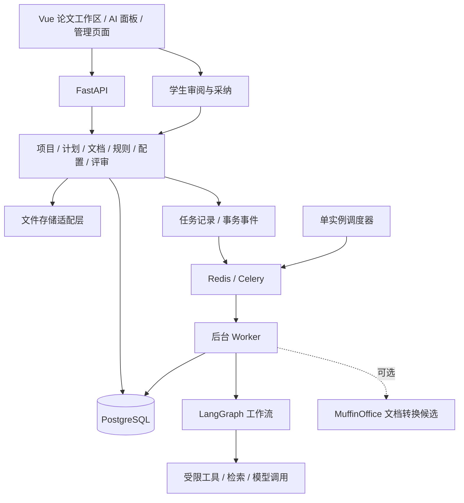

# 功能架构与技术栈

更新：2026-11-11。本文记录确认的技术方向和设计；当前开始隔离交互原型与编辑器小样，正式应用及其运行验证尚未完成。范围以[产品方案](../product/proposal.md)和[验收标准](../product/acceptance.md)为准。

## 1. 技术栈与取舍

| 层次 | 选型 | 推荐理由与关键取舍 |
|---|---|---|
| 前端 | Vue 3、TypeScript、Vite+ | 组件化论文工作区和管理页面，用类型约束接口与编辑器适配层 |
| 界面 | Tailwind CSS、daisyUI | 统一样式与主题；daisyUI 不替代复杂表格、编辑器及可访问性交互实现 |
| 页面与状态 | Vue Router、Pinia | 管理路由、面板和项目状态；不复制多份独立可写的论文 |
| 前端工程 | Vite+，底层 pnpm | 统一管理 Node、依赖、开发、检查、格式化、构建与测试；vue-tsc 补足 Vue 类型检查 |
| 后端 | Python、FastAPI、Pydantic | 业务接口和结构校验；长文解析、评审、模型调用放后台任务 |
| 数据 | PostgreSQL、SQLAlchemy、Alembic | 事务、版本并发控制和迁移；增加服务运维，但适合并发任务和采纳保护 |
| AI 编排 | LangGraph | 固定工作流、工具调用和暂停恢复；正式写入权限仍由业务服务控制 |
| 后台任务 | Celery、Redis | 解析、评审、导出与周期检查脱离 HTTP 请求；必须处理重复执行和取消 |
| 编辑器接入方向 | 开源编辑内核 + 自行实现 Vue/daisyUI 外壳 | 具体内核由原型验证确定；获得风格与交互控制，同时承担复杂对象和往返兼容验证 |
| 可选文档转换 | MuffinOffice 0.1.1 用户提供包 | 仅作为服务端候选；现有研究不代表已接入，不等待其浏览器 SDK |
| Python 工程 | uv、Ruff、pytest | 依赖锁定、静态检查、保护规则与事务测试 |
| 界面验收 | Playwright | 验证选区、采纳、撤销、面板切换与导出等真实操作 |

技术方向确认不等于依赖锁定或兼容性验证通过。Python、Node、框架和数据库的精确版本在首次安装时选择兼容稳定版本并保存锁文件。模型供应商、模型型号、部署环境与外部接口凭据仍待定。

### 前端工具版本

2026-11-11 核验注册表后选择 `vite-plus` **1.6.0**、底层 pnpm **11.25.0**。Vite+ 集成 Oxlint **1.93.0**、Oxfmt **0.78.0** 和 Vitest **5.1.0**，不再分别选择直接 Vite、Oxlint、Oxfmt 工程依赖。Node **26.13.0** 通过原型目录的 `.node-version` 交给 `vp` 管理，当前锁文件为 `pnpm-lock.yaml`。

- 在 `prototypes/workspace` 执行 `vp install --frozen-lockfile`、`vp dev`、`vp run check`、`vp build` 和 `vp run test:e2e`。
- `vp run check` 组合 `vp check` 和专门的 Vue 类型检查；Vue 类型及模板覆盖仍需按实际工具能力验收。
- `vp run test:e2e` 调度 Playwright；`vp test` 使用 Vitest，当前没有单元测试，不将空测试集计为通过。

当前工具链迁移与验证仍在执行；注册表版本核验不等于安装、兼容性或测试通过，实际结果见[迁移记录](../evidence/sessions/2026-11-11-viteplus-toolchain.md)。此前直接使用 npm、Oxlint 与 Oxfmt 的真实运行记录保留在原始开发证据中。

## 2. 部署关系

采用一个仓库、模块化单体后端。API、后台任务和调度器分进程运行，不为每个智能体建立微服务。若选用 MuffinOffice 转换，则作为独立 Linux/amd64 服务通过内部 HTTP 接口接入；它不是浏览器编辑的前置条件。

完整功能结构见 [SVG 架构图](diagrams/thesis-pilot-architecture.svg)。图中模块表示职责，不代表独立部署单元或已经实现。

## 3. 功能模块映射

| 模块 | 实现方式 | 核心边界 |
|---|---|---|
| 论文主工作区 | Vue/daisyUI 外壳 + EditorAdapter + 待选开源编辑内核 | 文档 schema、编辑事件、选区锚点先验证；不按页面坐标直接改正文 |
| 统一/专业 AI 面板 | Pinia 保存界面与会话上下文，后端协调任务 | 共享论文版本；切换保留光标、选区和未保存编辑，多面板不代表多次自动调用模型 |
| 项目、进度、计划 | PostgreSQL 状态与依赖，确定性日期计算 | 学生确认完成后更新派生进度；计划变更先生成候选再采纳 |
| 主动辅助 | 业务事件 + 定时扫描 + 合并、去重、冷却 | 无编辑不等于无进度；可延后、忽略，不持续打断输入 |
| 模板、资料 | 原件、版本、解析诊断、文档转换适配层 | 上传直接解析保存版本，不增加核对发布流程 |
| 论文要求 | Pydantic 结构 + 来源锚点 + 规则执行器 | 可判定硬规则由代码执行，语义要求提供证据及不确定性 |
| 受控修订 | 候选补丁、差异展示、事务应用 | 模型不能直接写正文；采纳时复验版本与保护规则 |
| 论文评审 | 硬规则检查、语义评审、报告汇总 | 仅评审可独立运行，参考分不能冒充教师评分 |
| 文献检索 | 检索适配器、元数据及引用核验 | 外部服务待定；标明摘要与全文范围，不伪造来源 |
| 四库管理 | Vue 管理页 + FastAPI CRUD + 配置版本 | 智能体、提示词、AI API 接口、模型分别维护，任务绑定版本 |
| 通知、任务状态 | 站内记录，SSE 候选及断线后状态查询 | 不依赖浏览器持续在线；邮件等渠道未选定 |

系统底座包括基础用户/登录会话、文件、资料、字典、通知、任务状态。租户、学校层级、角色权限体系暂不展开；不因此将密钥或管理接口开放到公网。

## 4. 数据与任务控制

核心实体建议：Project、Document、DocumentVersion、TemplateVersion、RequirementVersion、Feedback、Task、PlanVersion、Suggestion、ReviewRun、ReviewReport、Notification、AgentVersion、PromptVersion、ProviderConfigVersion、ModelConfigVersion、Job。实体和迁移尚未实现。

文件通过存储适配层保存，数据库记录摘要、位置、版本和状态。初期可用受控本地目录，保留对象存储替换接口；未预设云平台。文档内部 schema 在开源编辑内核与文档往返小样验证后确定，不用纯文本覆盖含公式、表格的结构文档。

正式修订协议：

1. 固定基础论文版本、选区锚点、模板及规则版本，生成候选。
2. 程序检查选区、数字、引用、公式、锁定文本及结构；无法安全解析的对象锁定或拒绝修改。
3. 用户审阅差异并采纳；部分接受后重新检查组合结果，拒绝重叠补丁。
4. 事务内再次检查基础版本、候选状态和保护规则，原子保存新版本及采纳记录；冲突要求重新审阅。
5. 失败保持原稿；撤销形成可追溯恢复版本。重复请求、取消后迟到响应不能重复应用或覆盖正文。

任务状态建议：待开始→进行中→待核验→已确认，返工保留历史。达到字数或模型判断通过不能自动完成学生确认。

PostgreSQL 是业务事实和任务状态来源。采用事务事件（outbox）协调数据库与后台派发，并设置幂等键；不假设数据库和 Redis 天然原子提交。Celery 管执行，LangGraph 管工作流步骤与暂停恢复，避免各自维护矛盾的完成状态。初期仅一个定时调度器，Redis 不作为论文或报告的唯一持久存储。

Celery worker 推荐在 Linux 运行；Windows 开发机使用经验证的 WSL2 或容器环境，不将原生 Windows worker 作为验收基线。

## 5. 智能体与主动辅助

全局智能体协调文献查询、论文辅助、格式规范、进度管控、论文评审五个专业智能体，共用受限工具和规则执行层。角色不必对应不同模型实例，按效果、时延和费用验证配置。

主动辅助入口为明显延期、持续缺乏可观察进展、章节完成、阶段完成等事件。先由程序判断、去重、合并，再按需调用模型。冷却、静默时段和风险阈值可配置，数值经试用确定。提醒解释依据和不确定性，不能将“没编辑”直接断言为“没工作”。

学生可填写个人规划；没有规划时根据已知截止和产物判断，不编造个人效率。学生确认完成后系统自动更新派生进度和风险；修改日期、任务范围或论文仍需采纳。

检索先采用章节/来源定位和 PostgreSQL 关键词查询。pgvector 与嵌入模型作为需要语义检索时的候选，先评估资料规模和命中率，不默认增加独立向量数据库。

## 6. 模板、要求与评审

模板保存原件、解析结果、诊断、版本和支持范围。要求提取保存原句、页码/段落来源、适用范围、规则类型、参数及抽取不确定性。上传即解析和保存版本，不设核对发布门槛；解析缺失或冲突必须可见。管理员可纠正提取结果并形成新版本。

当前论文绑定模板和要求版本；暂不做规则更新影响分析或全量迁移。字体、引用数量等可确定判断的规则由代码校验；论证和内容完整性输出带依据的语义判断。提示词不能保证模型永不违背要求，程序校验与正式写入入口承担硬边界。

评审固定论文、规则、模板、评分量表及配置版本，输出问题清单、严重程度、位置、依据、建议、分项参考分、未检查项与汇总报告。缺证据时标为不能判定，不捏造实验或引用。仅评审只生成检查产物；学生决定修改时创建独立修订任务。报告可导出供教师参考，不默认建设教师账号体系。

python-docx、lxml、pdfplumber 作为资料解析和确定性检查的补充候选，按编辑器及文档转换链路的实测缺口决定是否引入；不承诺保真 Word 排版，不允许二次解析静默损坏复杂对象。

## 7. 四库管理

| 库 | 主要字段 | 约束 |
|---|---|---|
| 智能体库 | 职责、允许工具、输出结构、提示词及模型引用 | 不通过配置页面上传任意可执行代码 |
| 提示词库 | 模板、变量定义、版本、适用任务 | 论文和检索内容是不可信数据，不能提升权限 |
| AI API 接口库 | 服务商、协议、地址、超时、限流、密钥引用 | 密钥服务端保存，浏览器及日志脱敏 |
| 模型库 | 模型标识、能力、上下文限制、参数、费用配置 | 能力与价格附来源及核验时间，不写死推测值 |

每次执行记录具体配置版本、输入文档版本、结果和诊断；不把完整私密论文、私人对话或密钥写入运行日志。

## 8. 实现前验证门槛

1. 在 `prototypes/workspace` 用 Vue 3 + TypeScript + daisyUI 可复用组件直接实现主工作区交互设计稿，样例数据及模拟服务与展示组件分离；本轮使用 Tiptap 开源核心制作编辑器小样，不代表正式内核已确定。按 [交互设计](../design/workspace-interactions.md) 检查布局、面板切换和审阅操作，不接入正式论文数据；正式后端尚未实现。
2. 优先验证开源编辑内核与自有 Vue/daisyUI 外壳，检查许可、输入法、文档 schema、选区锚点、编辑事务、撤销及保护对象；验证后确定具体内核，不等待 MuffinOffice 浏览器 SDK。
3. 用自制/授权样例验证导入—编辑—保存—导出，检查模板样式、公式、引用、图表、目录及页码；若采用 MuffinOffice 转换，另验 Linux/amd64 服务、鉴权与接口合同。
4. 在正式应用验证保护规则、版本冲突与原子采纳，再扩展主动事件；原型中对交互的验证不替代后端约束验收。
5. 锁定依赖并执行类型检查、后端测试及浏览器流程；19 项产品 AC 仍未执行，文档检查不替代产品验收。

详见 [MuffinOffice 接入研究](integrations/muffin-office.md)。框架依据：[FastAPI](https://fastapi.tiangolo.com/)、[LangGraph](https://docs.langchain.com/oss/python/langgraph/overview)、[Celery](https://docs.celeryq.dev/en/stable/)、[SQLAlchemy](https://docs.sqlalchemy.org/en/20/)、[daisyUI Vue 安装](https://daisyui.com/docs/install/vue/)。
