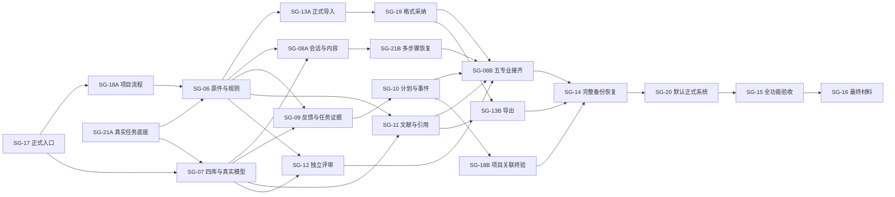

# 从设计展台到完整业务系统的实施计划

更新：2026-11-17。用户要求排查、排期并调整施工单，使施工能够交付整个规划系统。本文件说明范围、依赖和验收；**状态、认领、提交及交付只在[施工单](construction-orders.md)记录**。本轮是规划调整，未实施新增业务。SG-04 的人工保护预期仍待确认，已有工程成绩不重复计为本轮测试。

## 1. 核对结论与目标

当前工程已经具备真实项目名称、正式稿版本和受控修订、诊断任务，但不能据此把十二页称为完整业务系统。主要证据：

| 已核对事实 | 位置 | 规划修正 |
|---|---|---|
| App直接挂载LabShell，根路由是展台总览，业务页仍为`/screens/*`；默认服务为preview | [App](../../apps/web/src/App.vue)、[router](../../apps/web/src/router.ts)、[runtime](../../apps/web/src/services/runtime.ts) | SG-17先建正式应用入口，SG-20交付默认正式产物；保留独立展台，不重做书桌布局 |
| HTTP模式仍经过本机工作区，空存储会初始化样例；项目接口只含名称/版本 | [工作区初始化](../../apps/web/src/lab/state/previewWorkspace.ts)、[项目schema](../../apps/api/src/thesis_pilot/modules/projects/schemas.py) | SG-18项目/流程持久化；正式状态与演示样例隔离，旧数据显式按领域迁移 |
| 正式稿候选由浏览器确定性预览生成后提交；正文采纳事务已是真实服务 | [remoteRevisions](../../apps/web/src/lab/state/remoteRevisions.ts)、[修订事务](../evidence/sessions/document-revisions.md) | SG-08替换生成来源，继续复用SG-04；不能把保护通过等同于真实模型接入 |
| 任务模型/DTO与worker当前只接diagnostic | [Job模型](../../apps/api/src/thesis_pilot/modules/jobs/models.py)、[Job schema](../../apps/api/src/thesis_pilot/modules/jobs/schemas.py)、[worker](../../apps/api/src/thesis_pilot/workers/tasks.py) | SG-21统一真实业务任务及持久编排；每种业务再实测，诊断通过不能代替 |
| 现有接口权限为共享服务令牌，Vite代理替请求注入；不是正式会话 | [认证依赖](../../apps/api/src/thesis_pilot/api/dependencies.py)、[开发代理](../../apps/web/scripts/api-proxy.ts) | SG-17定义真实本机工作区会话，SG-20生产同源入口不依赖Vite开发服务器 |
| 现有格式候选、引用、导入导出与完整备份缺少正式全链路负责人 | [页面缺口](../design/page-functional-design.md)、[DOCX小样](docx-roundtrip.md)、[导出页](../../apps/web/src/lab/screens/ScreenExport.vue) | 新增SG-19；扩大SG-11引用写入、前移SG-13A导入、补齐SG-14对象闭包 |

推荐目标为**本机单人可持续使用的真实业务应用**：沿用现有Vue/Tiptap/四主题和FastAPI/PostgreSQL/Redis/Celery/LangGraph，优先使用已验证的Linux/WSL运行环境。业务事实持久化在服务端，设备偏好和隔离编辑草稿可本地保存。工作区有真实进入/退出/失效/撤销及同源写入检查，不能把回环地址或共享令牌当作已完成权限隔离；不增加学校租户、教师账号、角色管理、多人协同或跨设备同步产品。

正式根入口直接进入当前项目或首次设置，正常工作不经过展台；展台通过独立显式命令/入口保留原有设计与演示用途、隔离存储和产物。正式路由复用页面与共享组件，迁移路由不要求机械搬动全部`lab`文件。SG-17初期显式启动正式产物供逐单接入；SG-20才将默认使用入口和交付说明切为正式系统。未实现能力不能用假按钮、样例或成功提示填充；施工期缺口不得在最终切换时靠隐藏入口算完成。

## 2. 排期与依赖

本次采用相对有效施工日，**不是日历完工承诺**。T0为后续业务明确开工、所需环境可用之日；以主协调者整合/实测、最多三个子代理并行为估算前提。业务主体初估22—37个有效施工日，最终材料另2—3日；每波结束依据实际工作量重排。人工样例、真实试用、外部来源/模型可用性和额外授权等待单独记录，不算“自动完成”，也不为追日期删功能。原11月17日目标不再作为未完成工作的虚假截止。

| 波次 | 估算窗口 | 并行施工与交接 | 退出结果 |
|---|---|---|---|
| W1 正式入口与任务基础 | T+1—4，约2—4日 | SG-17与SG-21A；同时准备SG-04人审清单、来源/格式风险核对 | 可独立启动正式应用；现有正文真链路可用；业务任务契约冻结 |
| W2 项目与配置底座 | 累计4—7日，本波2—3日 | SG-18A；SG-07可并行，SG-06在项目/绑定契约冻结后准备原件 | 完整项目/流程事实、首次设置和四库真实调用基础 |
| W3 原件与正式导入 | 累计7—12日，本波3—5日 | SG-06A→SG-13A；SG-06B与SG-07收尾按独占文件并行 | 资料/模板/要求真实保存；DOCX导入与空稿开始两路均进入正式编辑器 |
| W4 内容、反馈与文献 | 累计11—18日，本波4—6日 | SG-08A、SG-09、SG-11；SG-21B随第一条真实多步骤运行验证 | 真实内容候选、任务证据/反馈、文献与引用写入均有完整链路 |
| W5 专业能力与计划 | 累计15—24日，本波4—6日 | SG-10、SG-12、SG-19 | 真实计划/通知、独立评审、格式候选采纳及撤销 |
| W6 接齐所有工作空间 | 累计18—29日，本波3—5日 | SG-08B、SG-13B、SG-18B；SG-14按已冻结对象准备 | 五专业与综合助手接齐；正式导出、项目绑定/阶段联动完整 |
| W7 恢复与默认切换 | 累计20—33日，本波2—4日 | SG-14终验→SG-20终验；运行包可提前准备，不提前判通过 | 全对象恢复和正式运行包；默认真实业务、独立展台 |
| W8 系统验收 | 累计22—37日，本波2—4日 | SG-15，修复缺陷后对应复测；人工试用按实际安排 | 全功能子条目、十二页、19项AC及正式切换门槛通过 |
| W9 最终材料 | 累计24—40日，另2—3日 | SG-16最终制作/核验；证据采集此前每波持续 | 真实版本、三条完整链、视频/PDF与评审复现；外部提交仍需实际回执 |

这些窗口按最快/最慢累计估算表示，不把“约2—4日”写成已经投入的实耗。每单先冻结功能流程、DTO和共享文件归属；契约就绪不等于整单完成。可并行实现不同后端模块与专属组件，不能并写ScreenWrite、资料/配置页、API入口、迁移、错误码或生成契约。主代理统一排整合时段并实际验收。

依赖中的A/B只表示同一单的里程碑，整单状态仍只有一处。关键链为：

图突出关键前后置，完整依赖以施工单每项为准。SG-12独立使用共享任务/配置，不再等待SG-08B，避免“评审等综合助手、综合助手等评审”的循环；SG-21A先提供基础，B依真实业务复验，不让业务等待尚不存在的真实检查点证据。SG-18B等任务/资料联动，其他单仅依赖18A。SG-04人工门槛不得因并行而跳过：独立底座可施工，正式AI采纳开放、SG-20/15收单仍受其约束。

## 3. 功能逐项覆盖规则

需求来源为[产品方案](../product/proposal.md)、[F01—F20完整功能](../design/full-mock-functional-requirements.md)及[交付功能设计](../design/delivered-functional-design.md)。F编号继续沿用。为防止只覆盖模块名，下面按每个F节的一级需求条目顺序固定`Fxx.nn`，多子句仍须全部实现/验证；既有编号不得重排，新增条目追加。原需求中“模拟”描述的是设计阶段，正式页面须替换为本表指定的真实业务；测试场景保留于展台，不搬进正常操作。明确非目标继续排除，不借此增加反馈上传/OCR或教师审批。

| 功能与原文需求编号 | 既有设计切片（不重编号） | 主责施工单 | 正式完成范围（原文各子句均保留） |
|---|---|---|---|
| F01 基础用户与会话：`R-F01.01`—`R-F01.04`（4条） | `F01.01`—`F01.04` | SG-17，通知策略SG-10 | 真实本机会话和个人偏好；失效保留草稿，演示会话管理留展台 |
| F02 论文项目与首次设置：`R-F02.01`—`R-F02.06`（6条） | `F02.01`—`F02.06` | SG-18，入口SG-17、正文SG-03/13A | 项目全生命周期、首次设置、空稿/导入、有/无规划、完整版本绑定与隔离 |
| F03 毕设流程与阶段配置：`R-F03.01`—`R-F03.05`（5条） | `F03.01`—`F03.07` | SG-18，确认/派生SG-09/10 | 流程阶段配置/停用/版本、条件/产物/依赖、学生确认，不追改历史绑定 |
| F04 论文编辑与文档结构：`R-F04.01`—`R-F04.08`（8条） | `F04.01`—`F04.10` | SG-02/03/13，格式SG-19 | 正式编辑器、结构/锚点/锁定、手动编辑、对象支持矩阵、导入保存及导出 |
| F05 AI 修订、审阅与版本历史：`R-F05.01`—`R-F05.08`（8条） | `F05.01`—`F05.08` | SG-04/08，引用SG-11、格式SG-19 | 内容/引用/格式三类固定输入候选，程序保护、决定/采纳/撤销/恢复及并发 |
| F06 综合 AI 与专业 AI：`R-F06.01`—`R-F06.08`（8条） | `F06.01`—`F06.07` | SG-08A/B，运行SG-21 | 综合及五专业真实职责、持久会话/历史/上下文、多面板和部分失败 |
| F07 任务、个人计划与进度：`R-F07.01`—`R-F07.09`（9条） | `F07.01`—`F07.08` | SG-09/10，项目约束SG-18 | 独立任务全管理、真实证据版本/确认返工、计划候选/采纳撤销及硬约束 |
| F08 主动辅助与通知：`R-F08.01`—`R-F08.08`（8条） | `F08.01`—`F08.08` | SG-10，偏好SG-17、事件SG-09/18 | 真实事件和线下进展、通知全状态、去重冷却静默、可解释来源及重访 |
| F09 导师反馈：`R-F09.01`—`R-F09.06`（6条） | `F09.01`—`F09.07` | SG-09，真实生成SG-07/21 | 仅粘贴原文、拆解/纠正、任务/修改证据、学生处理与撤销历史 |
| F10 文件、资料与知识库：`R-F10.01`—`R-F10.07`（7条） | `F10.01`—`F10.07` | SG-06，运行SG-21 | 真实原件、分类、解析/纠正版本、知识来源检索、关联解绑与历史；分类不新增反馈上传 |
| F11 模板导入、解析与版本：`R-F11.01`—`R-F11.07`（7条） | `F11.01`—`F11.06` | SG-06/19/13 | 模板解析/纠正/绑定与安全格式采纳、撤销及导出保持 |
| F12 论文要求抽取与管理：`R-F12.01`—`R-F12.07`（7条） | `F12.01`—`F12.07` | SG-06/19，语义消费SG-08/12 | 要求来源、范围、类型/严格度/冲突、编辑停用版本；硬规则实执行，语义附依据 |
| F13 文献查询与引用辅助：`R-F13.01`—`R-F13.06`（6条） | `F13.01`—`F13.07` | SG-11，资料SG-06、助手SG-08 | 真实检索和取得范围、保存/多篇上下文、引用专用采纳写入与撤销 |
| F14 论文评审与仅评审：`R-F14.01`—`R-F14.08`（8条） | `F14.01`—`F14.06` | SG-12，评审专业SG-08B | 固定输入、独立真实报告/问题/依据/评分局限、定位/历史/下载及显式另建修订 |
| F15 智能体库：`R-F15.01`—`R-F15.05`（5条） | `F15.01`—`F15.05` | SG-07，实际消费SG-08 | 智能体全管理、版本/关联/能力/工具边界、真实运行与旧配置可追溯 |
| F16 提示词库：`R-F16.01`—`R-F16.05`（5条） | `F16.01`—`F16.05` | SG-07，各生成业务消费 | 提示词全管理、变量/结构校验、复制比较与版本快照，不可信材料隔离 |
| F17 AI API 接口库：`R-F17.01`—`R-F17.05`（5条） | `F17.01`—`F17.04` | SG-07，运行SG-21 | API配置/凭据引用/版本、真实测试及故障、被任务使用可追溯，不泄漏秘密 |
| F18 模型库：`R-F18.01`—`R-F18.05`（5条） | `F18.01`—`F18.05` | SG-07，各模型业务消费 | 模型能力/参数/有效关联/停用/版本、真实测试与固定配置，不静默换型 |
| F19 系统配置、执行任务与诊断：`R-F19.01`—`R-F19.05`（5条） | `F19.01`—`F19.07` | SG-18/06/10配置，SG-21及各业务任务 | 字典/分类/阶段/提醒设置，各真实任务全状态、输入版本、产物、诊断和重试 |
| F20 导出、备份与恢复：`R-F20.01`—`R-F20.05`（5条） | `F20.01`—`F20.08` | SG-12/13/14，运行SG-20 | 论文/报告/修改说明/备份分开执行；真实格式文件、完整关系及损坏拒绝 |

合计20个模块、127条原文一级需求及132项既有设计切片；另有下列7项全局契约。计数用于防遗漏，不是已完成功能数。

既有设计切片来源为[工作区与写作](../design/audits/workspace-writing.md)、[任务与资料](../design/audits/tasks-materials.md)、[评审与配置](../design/audits/review-settings.md)、[通知与导出](../design/audits/notifications-export.md)，保留历史设计完成结论，另验正式业务结果。全局契约单列如下，不能被20个模块的计数漏掉。

| 契约 | 正式业务要求 | 主责与终验 |
|---|---|---|
| G.01 | 跨页上下文、未提交草稿和空项目不丢失/串用 | SG-17/18/08，SG-15 |
| G.02 | 项目阶段航线、截止与保存状态来自真实事实 | SG-17/18/10，SG-15 |
| G.03 | 指令面板实际搜索业务对象并发起受控AI请求，不仅搜索页面名 | SG-17搜索/导航、SG-08请求、各业务提供对象查询，SG-15 |
| G.04 | 调宽/收起、窄屏抽屉、多个助手并排保留同一编辑器及上下文 | SG-17/08，SG-15 |
| G.05 | 全局键盘、焦点返回、错误后输入和草稿保留 | SG-17及各单，SG-15 |
| G.06 | 四主题/减弱动效/偏好恢复，实际对照设计稿 | SG-17及各单，SG-15 |
| G.07 | 写作中真实任务期限提示、来源与定位 | SG-09/10/08，SG-15 |

各单开工必须逐个子条目登记“入口→输入/操作→真实契约及事实来源→结果/异常/恢复→跨页对象→验证证据”，不适用需给出原需求依据，不能将未实现改成不适用。下表只分配责任，**不把列出编号当作功能已通过**。SG-15逐项核对表内全部编号，再与原文多子句及十条完整使用流程对照；任一无负责人、无入口、无恢复或无证据即保留缺口。

## 4. 十二页正式接通表

| 页面 | 当前仍需接通的正式业务 | 主责与终验 |
|---|---|---|
| 项目 | 名称之外的首次设置、阶段/期限/绑定、归档恢复，真实空态 | SG-17/18，SG-06/09/10补关联；SG-18B |
| 今日 | 同一项目正式正文、任务证据、反馈、阶段确认和真实事件派生 | SG-18/09/10 |
| 写作 | 同一编辑器、正式文档默认来源、真实候选与会话、模板/引用/评审深链 | SG-03/04保留；SG-08/11/19/13，入口SG-17 |
| 计划 | 独立任务、依赖/证据、个人规划、计划版本及采纳/撤销 | SG-09/10，阶段事实SG-18 |
| 资料 | 不可变原件、解析/模板/要求/知识、真实文献与来源/版本 | SG-06/11，正式论文导入SG-13A |
| 反馈 | 原文、真实拆解、纠正、任务/证据、学生处理/撤销历史 | SG-09 |
| 评审 | 真实任务、固定量表/版本、问题定位、报告历史及下载 | SG-12；进入修改走SG-04/08/19 |
| 配置 | 四库及真实试跑、流程/字典/分类、通知偏好，故障开关留展台 | SG-07/18/06/10；共享运行SG-21 |
| 收件箱 | 持久事件、已读/延后/忽略/关闭/重访、来源对象跳转 | SG-10 |
| 执行任务/托盘 | 所有真实业务类型、固定输入版本、结果/尝试、取消/重试 | SG-21与各业务单逐类复验 |
| 导出备份 | 选择正式版本、DOCX/论文PDF/报告/真实变更说明、完整恢复 | SG-12/13/14；不能下载本机影子稿冒充正式稿 |
| 账户与偏好 | 本机个人工作区真实进入/失效/退出、资料偏好及通知设置 | SG-17/10；主题可设备端，演示用户/会话工具留展台 |

每条跨页链接携带稳定服务/项目/文档/来源版本，支持刷新、前进后退和旧版本定位；不能靠标题或裸`v1`猜对象。书桌三栏、共享表单/空态、按钮主次/选中态、点击范围和按需详情保持设计规范，内部标识不占默认工作区。

## 5. 产品AC归属

以下均为实施及取证责任，现有19项AC的完整状态不变；最终统一由SG-15在SG-20产物验收。

| AC | 实施与证据责任 |
|---|---|
| AC-001 | SG-17/18项目及入口，SG-03/06/09/10持久化，SG-14恢复 |
| AC-002 | SG-02边界、SG-06原件、SG-13A正式导入 |
| AC-003 | SG-09证据/确认/返工，SG-10派生进度，SG-03/06精确版本 |
| AC-004 | SG-09原文与真实拆解，SG-07/21真实调用 |
| AC-005 | SG-04受控边界、SG-08真实内容，SG-11/19扩展候选类型 |
| AC-006 | SG-04人工保护样例；SG-11/19扩展后重验保护与结构 |
| AC-007 | SG-04决定/采纳/撤销，SG-08/11/19各类真实候选 |
| AC-008 | SG-03/04并发版本，SG-08/11/19迟到与陈旧候选 |
| AC-009 | SG-09任务、SG-10计划事务/约束，SG-18截止/阶段 |
| AC-010 | SG-05/21可靠性，SG-07及SG-06—13每类真实任务逐一复验 |
| AC-011 | SG-13B正式导出，SG-04/11/19真实变化与格式结果 |
| AC-012 | SG-14全对象与原件一致恢复，SG-20干净实例 |
| AC-013 | SG-06原件/模板版本，SG-18项目绑定 |
| AC-014 | SG-06要求与规则、SG-19格式执行，SG-08/12共享语义上下文 |
| AC-015 | SG-08B真实综合/五专业/多面板，SG-17工作区，SG-21B恢复 |
| AC-016 | SG-10真实事件/通知，SG-09证据，SG-17偏好及SG-18阶段 |
| AC-017 | SG-07四库与SG-08/09/10/11/12实际运行消费 |
| AC-018 | SG-12独立只读报告；SG-08B评审专业不扩大权限 |
| AC-019 | SG-11真实来源/引用，SG-06保存版本，SG-08上下文 |

## 6. 正式切换硬门槛

| 编号 | 可执行验收 | 不通过情形 |
|---|---|---|
| PROD-01 正式入口 | 构建正式产物，关闭Vite开发服务；空浏览器/空业务库访问根入口，完成首次设置；独立浏览器访问同一实例恢复项目事实 | 先进入LabShell、依赖手工URL参数进入正式稿、自动种样例、要求开发代理才可使用 |
| PROD-02 全业务覆盖 | 按全部F子条目及十二页表操作；启动空稿与导入既有DOCX两条路径，完成项目→资料/要求→任务/反馈→写作/助手→决定/采纳/撤销→计划/通知→评审→导出/备份恢复 | 仅API可用、页面仍写本机模拟、假按钮、永久隐藏已规划能力、只有固定演示路径 |
| PROD-03 事实与恢复 | 保存后重启API/数据库/worker，再从无缓存浏览器核对；断开API后编辑/操作，恢复连接 | 本机保存显示服务端成功、错误退回Mock、清缓存丢正式数据、迟到覆盖草稿 |
| PROD-04 真实智能与来源 | 按已选配置实际调用模型，五专业与综合任务分别记录输入范围/配置/产物版本；检索实际访问来源 | 浏览器定时器/固定候选/预置报告冒充真实执行，假文献或未读全文声明；确定性保护/求解器可继续复用 |
| PROD-05 权限及写入边界 | 核对真实会话失效/撤销、同源写入、原件下载/任务范围；三类候选都复验基础版本、保护和原子写入 | 演示登录、共享开发令牌当用户身份、模型可普通保存全文、跨项目混用或未经采纳改稿 |
| PROD-06 文件与备份 | 指定办公软件打开DOCX，渲染核对论文PDF；项目副本及干净实例完整恢复并检查原件/关系/任务状态 | 改扩展名、无关文件、缺原件只能恢复占位稿、遗漏对象、恢复自动重放旧写入/模型任务 |
| PROD-07 设计及操作 | 主代理逐页实际对照设计稿，四主题/窄屏/键盘/减弱模式、长文本/空态/加载/失败/冲突、深链往返 | 接服务后退化文字堆砌、控件不清楚、状态缺失、编辑器被重建、浮层遮挡与焦点错误 |
| PROD-08 完整交付 | SG-15在SG-20已通过PROD-01—07的正式产物上，完成19项AC、功能子条目与10分钟复现计时，披露外部依赖及用户试用状态；本项不反向作为SG-20前置 | Mock或回放替代真实链路、跳过关键用例算通过、文档通过当业务通过、材料制作当系统交付 |

## 7. 边界与开工前验证

- 已定DeepSeek官方接口与普通/复杂任务分级保持；SG-07用自制数据验证真实型号和错误边界，本文未进行新外部调用，也不保证当前可用性。实际用户论文外发范围在对应功能操作中明确，不以测试密钥授权替代论文授权。
- 检索来源和转换实现于SG-11/13开始前核验可达性、许可、输入输出及运行环境，按推荐的可用方案推进；需要新增费用/外发授权时仍执行对应边界，不用模拟永久填补。MuffinOffice继续为备选，不把其未验证能力写为已实现。
- 本轮推荐将论文PDF列为SG-13B明确规划目标，与必需DOCX一起验证；这属于对原可选转换能力的排期取舍，不是已经支持或要求实现通用排版引擎。无法达到时公开保留缺口与可行修订，不静默删去。
- 人工保护预期至少30组、反馈20条、计划10组仍按真实人工记录；3—5位目标用户试用如未开展保持未完成。AI不能代签，也不能以“按推荐”推断已经人工审阅。
- 各单只认领依赖满足的范围，完成后自动检查、中文提交、更新main台账并推送私有main。问题按已授权推荐修复并记录；公网部署、删除分支/工作树、报名/外发等不因本计划自动获准。

本轮核对仅涉及规划所需的源码/文档读取与规划修改；业务运行结果沿用已有证据，不重复跑全量测试来证明文档有效。规划覆盖和依赖检查、文档及证据校验结果记入施工台账。
